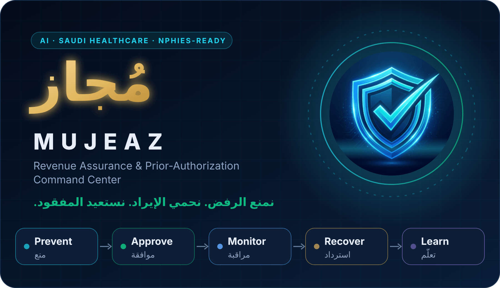
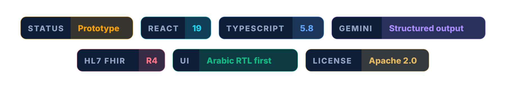
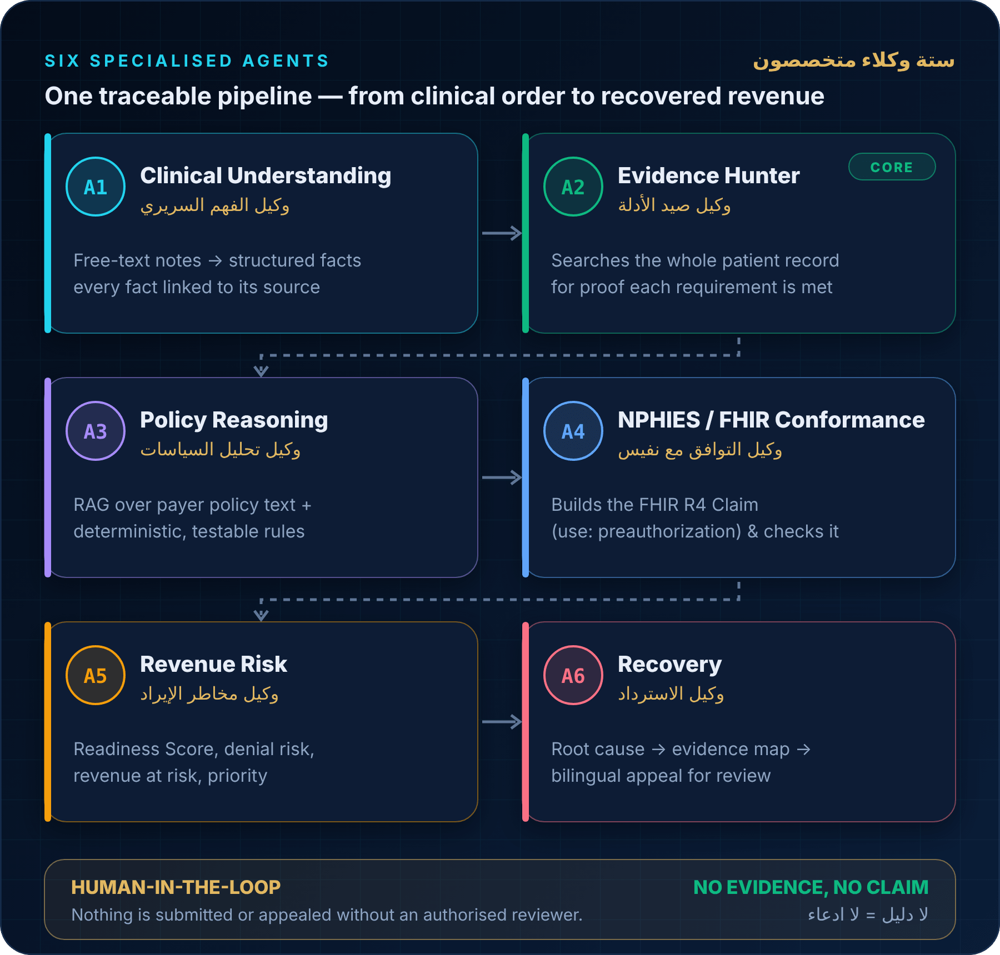
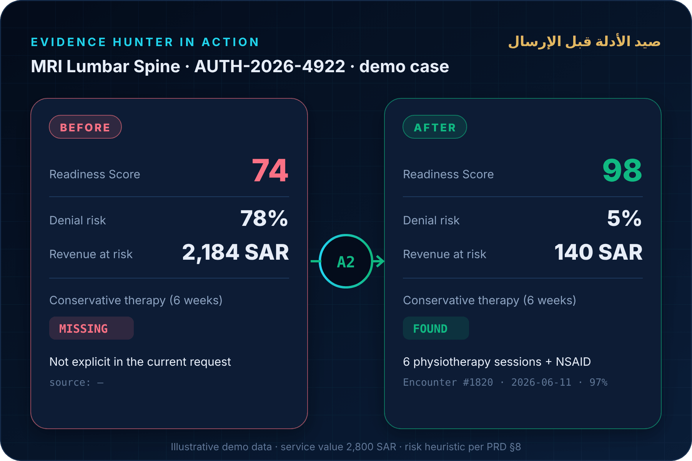
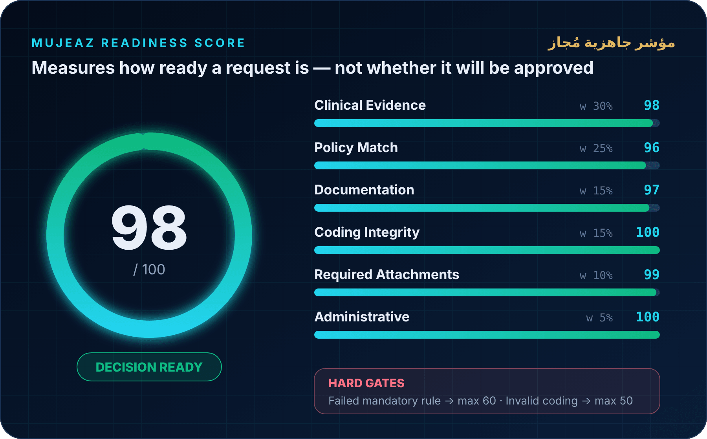
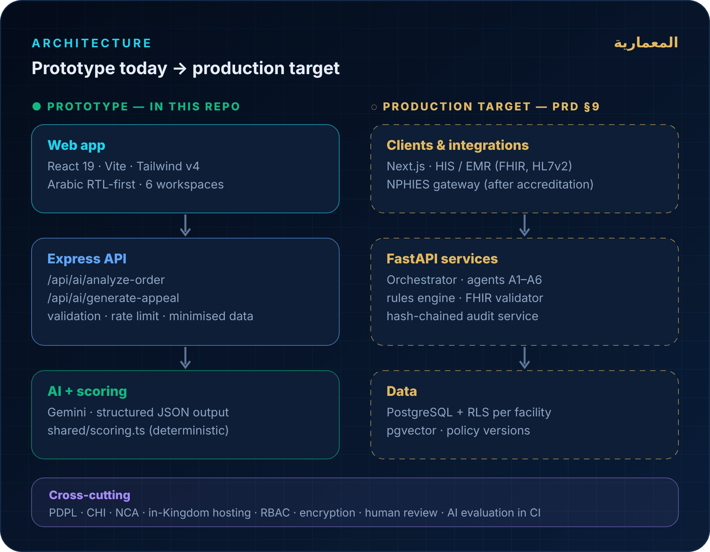

<div align="center">



<br/>



<br/><br/>

**[How it works](#-how-it-works) · [Readiness Score](#-mujeaz-readiness-score) · [Product tour](#-product-tour) · [Quick start](#-quick-start) · [PRD](docs/PRD.md)**

</div>

<br/>

<div dir="rtl" align="right">

### مُجاز في ثلاثين ثانية

**مُجاز** طبقة ذكاء تشغيلية بين أنظمة المستشفى السريرية ومسار التأمين (نفيس). قبل إرسال أي طلب موافقة مسبقة، يفهم الحالة، ويبحث تلقائيًا عن الأدلة داخل السجل الطبي، ويطابقها مع سياسة الجهة الدافعة، ويكشف أسباب الرفض المحتملة ويعالجها. وإذا وقع الرفض، يحلل سببه ويبني حزمة استئناف موثقة بالمصادر وجاهزة للمراجعة البشرية.

> **لا ينتظر الرفض ليبدأ — يتنبأ به، يمنعه، وإذا وقع يحوّله إلى فرصة لاسترداد الإيراد.**

</div>

---

## ⚡ The problem

A medically correct request still gets **delayed or denied** because three processes run in isolation:

<table>
<tr>
<td width="33%" valign="top">

### 🩺 Clinical decision
The physician writes the order. The proof that conservative therapy was tried sits in a **different encounter** nobody attaches.

</td>
<td width="33%" valign="top">

### 📄 Payer authorization
Coverage rules, required attachments, diagnosis–procedure matching and coding all have to line up **before** submission.

</td>
<td width="33%" valign="top">

### 💰 Revenue cycle
Denials surface weeks later. Appeal teams start from zero — **after** the revenue is already at risk.

</td>
</tr>
</table>

**Existing tools cover one side.** Authorization tools submit without understanding the clinical context; appeal tools only start after the loss. Mujeaz joins both:

```text
Traditional        Submit → Wait → Denied → Manual work
Appeal-only        Denied → Appeal
Mujeaz             Understand → Validate → Predict → Complete → Submit → Monitor → Recover → Learn
```

---

## 🧠 How it works

<p align="center">
  
</p>

Each agent has one job, a typed output, and an audit trail. Language understanding comes from the LLM; **anything that decides a number or a rule outcome is deterministic and testable**.

<details>
<summary><b>What each agent does today (milestone M1)</b></summary>

<br/>

| | Agent | Prototype status |
|---|---|---|
| **A1** | Clinical Understanding | Extracts facts from every document in the record; each fact is a verified verbatim span (baseline or Gemini) |
| **A2** | Evidence Hunter | Arabic/English BM25 over the whole record → FOUND / PARTIAL / MISSING, with a physician documentation query |
| **A3** | Policy Reasoning | Deterministic rules engine over versioned YAML policies; the model never decides an outcome |
| **A4** | NPHIES / FHIR Conformance | Sample `Claim` with `use: preauthorization`; profile validation planned |
| **A5** | Revenue Risk | Deterministic formulas, TypeScript reference + Python port with 250 parity vectors |
| **A6** | Recovery | Gemini appeal drafting from whitelisted evidence only |

</details>

### See it on a real case

<p align="center">
  
</p>

The physician already documented six physiotherapy sessions — just not in this request. **A2** finds them in Encounter #1820, attaches them with source and date, and the request moves from *Action Required* to *Decision Ready* before it ever reaches the payer.

---

## 🎯 Mujeaz Readiness Score

<p align="center">
  
</p>

- **Readiness, not a promise.** It measures how complete a request is — never the probability that a payer approves it.
- **Explainable.** Every missing point comes with the reason and the action that recovers it.
- **Reproducible.** Same inputs → same score. Computed in code, not generated by the model.

| Score | Label | Meaning |
|:---:|---|---|
| **≥ 90** | 🟢 Decision Ready | Submit after human review |
| **70 – 89** | 🟡 Action Recommended | Fix listed gaps first |
| **< 70** | 🔴 Action Required | Mandatory requirement or coding problem |

---

## 🛡️ No Evidence, No Claim

> [!IMPORTANT]
> Every clinical fact Mujeaz relies on carries **Fact + Source + Date + Confidence**.
> If the evidence is not in the record, Mujeaz reports it as **missing** — it never invents it.

```text
Physiotherapy — 6 sessions
Source:      Encounter #1820 · Physical Therapy
Date:        2026-06-11
Confidence:  97%
```

The same rule applies to appeal letters: the Recovery Agent may only cite evidence that exists in the case's Appeal Evidence Map.

---

## 🖥️ Product tour

| Workspace | What you get |
|---|---|
| 📊 **Command Center** | Revenue protected, at risk and recovered · prevented denials · active authorizations · recovery queue |
| ▶️ **Live Walkthrough** | Guided 7-stage MRI Lumbar Spine story, then a denial → recovery scenario |
| 🧬 **Digital Twin Inspector** | One case end-to-end: facts, rules, evidence, agent runs, FHIR payload, **SHA-256 hash-chained audit log** |
| 🧪 **AI Sandbox** | Paste any clinical note (Arabic or English) and run live analysis |
| 🔁 **Recovery Queue** | Denied cases with root cause, strategy and bilingual appeal drafts |
| 📚 **Policy RAG** | Browsable sample payer policy knowledge base |

All screens are bilingual, with Arabic RTL as the default.

---

## 🏗️ Architecture

<p align="center">
  
</p>

---

## 🚀 Quick start

```bash
git clone https://github.com/4-u1/Mujeaz.git
cd Mujeaz
cp .env.example .env                                  # optional: GEMINI_API_KEY for live AI
docker compose -f infra/docker-compose.yml up --build # → http://localhost:8080
```

Sign in as any demo role, for example **`sara.auth`** (authorization officer) or **`noura.audit`** (auditor). API docs: http://localhost:8000/docs. Running services without Docker, tests and troubleshooting: **[docs/RUNBOOK.md](docs/RUNBOOK.md)**.

> [!TIP]
> No API key? The app still runs. AI endpoints return a **clearly labelled sample** (`mode: "fallback"`) that is never presented as an analysis of your note.

| What you get | |
|---|---|
| **PostgreSQL 16 + pgvector** | Full PRD data model, Row-Level Security per organisation |
| **FastAPI backend** | RS256 auth, six roles, explicit case state machine, hash-chained audit |
| **53 cases** | 3 original demo cases + 50 synthetic MRI Lumbar Spine FHIR bundles |
| **React frontend** | Same six workspaces, now reading and writing through the API |

| Variable | Required | Description |
|---|:---:|---|
| `GEMINI_API_KEY` | — | Enables live AI. Server-side only. |
| `GEMINI_MODEL` | — | Overrides the Gemini model name. |
| `MUJEAZ_DEV_AUTH` | — | Development sign-in (`true` locally; must be `false` in production). |
| `MUJEAZ_JWKS_URL` | — | Use an external OIDC identity provider instead of the dev one. |

<details>
<summary><b>📡 API reference</b></summary>

<br/>

#### `POST /api/ai/analyze-order`

```json
{
  "clinicalNoteText": "45M, low back pain radiating to left leg for 8 weeks ... requesting MRI lumbar spine.",
  "payerName": "Demo Payer A",
  "requestedService": "MRI Lumbar Spine"
}
```

Returns diagnosis and procedure codes, source-quoted clinical facts, rule results, evidence findings, the readiness breakdown and revenue risk, plus:

| Field | Meaning |
|---|---|
| `mode` | `live` (model output) or `fallback` (static sample — not an analysis) |
| `notice` / `noticeAr` | Present in fallback mode; must be shown to the user |
| `scoring` | `method`, any hard `gateApplied`, and the source of the financial value |

Requires `case:analyze`. Limits: note ≤ 20,000 characters · 20 requests/min per user.

#### `POST /api/ai/generate-appeal`

Whitelisted fields only — **no patient name or ID reaches the model**:

```json
{
  "claimNumber": "AUTH-2026-8103",
  "payerName": "Demo Payer B",
  "requestedService": "Secukinumab 150mg SC — 12-month course",
  "denialReason": "Step therapy prerequisite unfulfilled",
  "clinicalNoteText": "…",
  "evidence": [{ "fact": "Severe allergic eruption on Adalimumab", "source": "Adverse Event Registry #1102", "date": "2026-03-20" }]
}
```

Returns `formalLetterEn`, `formalLetterAr`, `appealStrategy`, `appealStrategyAr`, `appealStrength` (the model's estimate of argument strength — not an overturn probability), `mode`, `notice`. Requires `appeal:draft`.

#### Cases, audit and auth

All endpoints except health, JWKS and dev sign-in need `Authorization: Bearer <token>`.

| Method & path | Permission | Purpose |
|---|---|---|
| `POST /api/auth/dev-login` | — (dev only) | Issue a token for a demo user |
| `GET /api/auth/me` | any | Current user, roles, permissions |
| `GET /api/cases` | `case:read` | List with `status`, `q`, `limit`, `offset` |
| `GET /api/cases/{id}` | `case:read` | Full case view (Digital Twin) |
| `POST /api/cases/{id}/transitions` | per transition | Move through the state machine; human gates recorded |
| `GET /api/metrics` | `metrics:read` | Command Center figures computed from stored data |
| `GET /api/audit/{id}` · `/verify` | `audit:read` | Hash-chained audit entries and server-side verification |
| `GET /healthz` · `/readyz` | — | Liveness and database readiness |

Errors use one envelope: `{"error": {"code", "message", "request_id"}}`.

</details>

<details>
<summary><b>🗂️ Project structure</b></summary>

<br/>

```text
.
├── backend/                   FastAPI service
│   ├── app/security/          JWT, RBAC, request dependencies
│   ├── app/audit/             Canonical JSON + hash-chained audit log
│   ├── app/scoring/           Python port of the scoring formulas
│   ├── app/cases/             State machine, case views, metrics, routes
│   ├── app/ai/                Gemini analysis and appeal drafting
│   ├── app/seed/              Demo organisations, users, policy, cases
│   ├── migrations/            Alembic (schema, RLS, roles, triggers)
│   └── tests/                 Unit + PostgreSQL integration tests
├── frontend/                  React 19 + Vite web app (src/api/client.ts is the network layer)
├── shared/                    TypeScript scoring reference + parity vectors
├── evals/                     Synthetic dataset generator + 50 MRI cases with ground truth
├── infra/                     docker compose + nginx
├── e2e/                       Playwright smoke test
└── docs/                      PRD, ADRs, architecture, security, runbook, evals
```

</details>

---

## 🗺️ Roadmap

| | Phase | Focus | |
|:---:|---|---|:---:|
| **M0** | Credibility | Honest labels, deterministic scoring, real audit chain, demo data | ✅ |
| **M1** | Foundation | FastAPI · PostgreSQL + pgvector · auth & roles · persistent audit | ✅ |
| **M2** | Intelligence | A1 + A2 + A3 on MRI Lumbar Spine · span verifier · eval gates in CI | ✅ |
| **M3** | Readiness | Rules engine · physician documentation query (CDI) | ⏳ |
| **M4** | Interoperability | NPHIES-profile `Claim` · real validation · labelled sandbox responses | ⏳ |
| **M5** | Recovery | Appeal Evidence Map · deadlines · retro denial audit | ⏳ |
| **M6** | Pilot | First facility · measured baseline · NPHIES test environment | ⏳ |

Full requirements: **[docs/PRD.md](docs/PRD.md)** · Plan: **[docs/IMPLEMENTATION_PLAN.md](docs/IMPLEMENTATION_PLAN.md)** · Design: **[docs/ARCHITECTURE.md](docs/ARCHITECTURE.md)** · **[docs/SECURITY.md](docs/SECURITY.md)** · **[docs/EVALS.md](docs/EVALS.md)** · Decisions: **[docs/adr/](docs/adr/)**

---

## ⚠️ Project status

> [!WARNING]
> **This is a prototype.** All patients, payers (Demo Payer A/B/C), facilities, policies and codes are **synthetic**. There is **no live NPHIES connection** — every payer response is simulated and labelled as such. Procedure and drug codes are reference codes, not SBS / NPHIES codes. Data lives in PostgreSQL; the dev sign-in is for local use only.

> [!NOTE]
> Mujeaz is **decision support**. It is not an insurer, a claims adjudicator or an accredited NPHIES body. Production use requires compliance with the Saudi **PDPL**, **CHI** requirements for NPHIES integration, **NCA** cybersecurity controls and the facility's own policies. Patient data must not be used to train models without a proper legal and contractual basis.

---

<div align="center">


### Yazeed Hamad Alharthi

### يزيد حمد الحارثي

Designed &amp; built in Saudi Arabia 🇸🇦

[github.com/4-u1](https://github.com/4-u1)

<br/>

<p dir="rtl"><b>مُجاز — نمنع الرفض. نحمي الإيراد. نستعيد المفقود.</b></p>

<sub>Licensed under Apache 2.0</sub>

</div>
